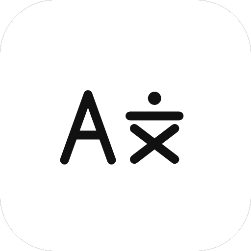
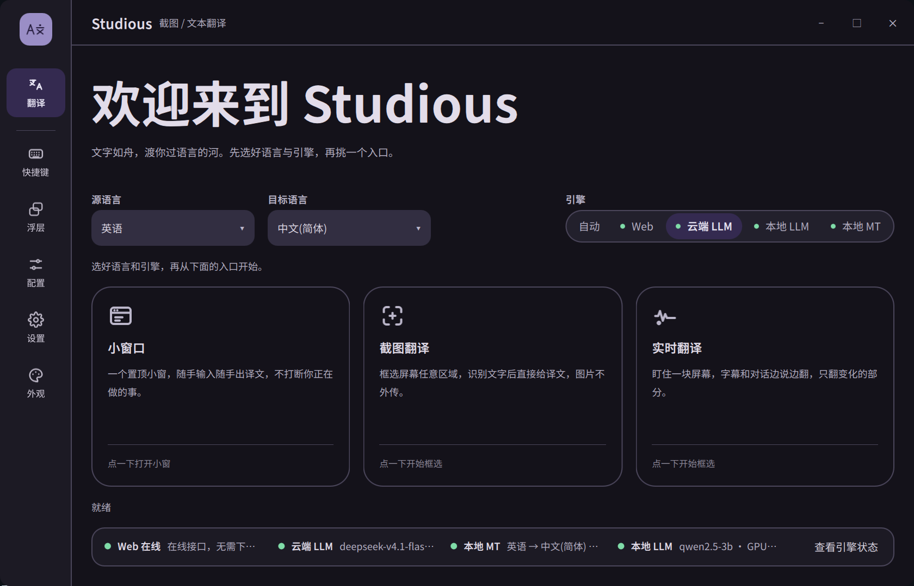
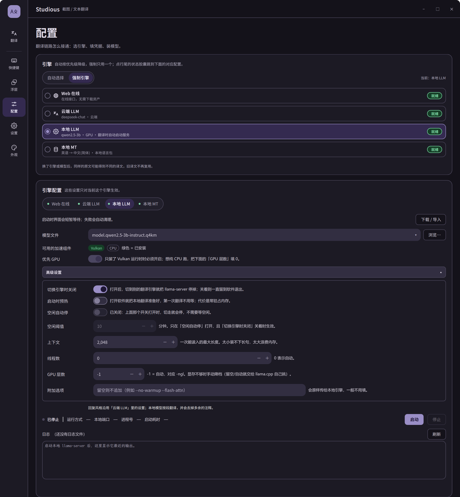

<p align="center">
  
</p>

<h1 align="center">Studious</h1>

<p align="center">Screenshot, selection and live translation — the foreign text on your screen becomes readable, in place.</p>

<p align="center">
  <a href="https://github.com/hua-2006/Studious/releases"></a>
  
  
  
</p>

<p align="center"><b>English</b> · <a href="README.md">简体中文</a></p>



## What it does

Most translation tools ask you to copy, switch windows, paste. Studious works on the screen you are already looking at:

- **Screenshot translation** — press a hotkey, drag a box over anything, and the translation is pasted on top of the original text. No window switching, no copying.
- **Mini window** — a small always-on-top window: paste a paragraph, hit Enter. Write emails or read docs without leaving what you are doing.
- **Live translation** — pin a region of the screen (video subtitles, game dialogue, an app UI) and it re-translates whenever the content changes, line by line.

14 languages including Chinese, English, Japanese and Korean. Translation can go through an online API or run fully offline: the local LLM and local language packs never touch the network, so capturing, recognising and translating never leaves your machine.

## Download

Grab the latest release (`v0.1.0`). Both packages have the same features — pick whichever suits you.

**Installer** · `Studious-0.1.0-setup.exe`

1. Double-click and click through. Installs per-user into `%LOCALAPPDATA%\Programs\Studious`, **no admin rights needed**.
2. A Start-menu shortcut is created. Uninstall from Settings → Apps, or run `unins000.exe` in the install folder.

**Portable** · `Studious-0.1.0-win64.zip`

1. Extract to an empty folder (**don't drag just the exe out** — the Qt DLLs live next to it).
2. Run `studious.exe`. Delete the folder to remove it.

> All data (models, cache, history, logs) lives in `data/` next to the executable — the installer works the same way, so you can copy the folder to another machine and keep going.
> Requirements: Windows 10 / 11 (64-bit). Windows only for now.

## First run, three steps

1. **Launch** — a four-page guide explains the three entry points and how to pick an engine. Click "Get started"; to see it again: Settings → General → "Show the welcome tour at startup".
2. **Record a hotkey** — Shortcuts → Screenshot translation → Record. Defaults are empty so nothing collides with other software.
3. **Try it** — press the hotkey, box some foreign text, click Translate, and the translation appears on top of it.

The OCR model screenshot translation needs is **bundled** (~20 MB), so recognition works right after install.
For offline engines, download the model and runtime in Configuration → Engine; a task card in the top-right shows download → verify → extract → install → Ready. For a cloud LLM, fill in the endpoint and key in Configuration → Cloud LLM.

## Three ways to use it

### Screenshot translation

Hotkey → drag a region (magnifier plus arrow keys for 8 px precision) → click Translate → the translation sits on top of the original and can be copied.

In Overlay → Screenshot you can turn on "Translate right after selecting" and "Close after copy".

### Mini window

Click "Mini window" on the Translate page, or press your hotkey: paste text, `Ctrl+Enter`. Results are tabbed per target language and can be copied paragraph by paragraph; the Records tab keeps history.

### Live translation

Translate page → "Live translation", or your hotkey → drag a region → "Start live translation". The control bar switches engine and language, locks the region, pauses and resumes.

Meant for subtitles, chat overlays and game dialogue — content that keeps changing. Frames with no text are skipped rather than stopping the session.

## Choosing an engine

| Engine | Needs network | Best for |
|---|---|---|
| **Web** | Yes | Works the moment you install it, no setup, good enough for everyday use |
| **Cloud LLM** | Yes | You have an OpenAI-compatible endpoint (DeepSeek, Qwen, your own gateway) and want more natural output |
| **Local LLM** | No | You have a discrete GPU and want the best quality without sending anything out |
| **Local MT** | No | Runs on CPU, fast enough for subtitles and live translation |

The default order is `Local LLM → Local MT → Cloud LLM → Web`: local first, falling through when one isn't installed. Timeouts and errors fall through automatically; "language pair not supported" stops instead of guessing.

Reorder by dragging in Configuration → Engine, or force a single engine.



## Interface tour

| Page | What's there |
|---|---|
| **Translate** | Start page: language, engine, and the three entry points; engine status bar along the bottom |
| **Shortcuts** | One global hotkey per mode, plus opening the main window; conflicts are flagged inline |
| **Overlay** | Details for the three overlays: magnifier, dimming, refresh interval, translation font size |
| **Configuration** | Engine priority and per-engine settings (API, model, threads, GPU layers, ...) |
| **Settings** | General, translation behaviour, cache, network, assets, data, about |
| **Appearance** | Light/dark mode, accent colour, UI and translation fonts, sizes |

The UI is bilingual; switch in Settings → General → Language (restart to apply).

## Privacy and data

- **API keys are encrypted with Windows DPAPI** and stored locally — they will not decrypt on another account or machine. No third-party endpoint or key is baked into the app.
- With local engines (Local LLM / Local MT) screenshots and text **never touch the network**; with online engines only the recognised text is sent, never the image.
- Everything lives in the `data/` folder next to the executable: models, cache, history, logs. Copy the folder to migrate; delete it to reset.
- Double-click the logo in the top-left corner to open the log window — the fastest way to see what went wrong.

## FAQ

**Local LLM / Local MT are greyed out as "not installed"?**
Their runtimes and models are too big to ship (only the OCR model is bundled). Download them in Configuration → Engine and watch the card in the top-right until it says Ready; or copy `data/assets` from another machine.

**Where does the installer put things?**
`%LOCALAPPDATA%\Programs\Studious` by default, with `data/` inside the same folder. You can install to `Program Files` for all users, but then `data/` needs admin rights to write — not recommended for daily use.

**Does it open a console window?**
No, it is a GUI app. Running it from a terminal with arguments attaches the console for debugging only.

**Can I run it from a USB stick or on another machine?**
Yes. It is portable and the data travels with the folder; just re-point the model path on the new machine.

**Screenshots of games come out black?**
Try a normal window first. Exclusive-fullscreen games often cannot be captured; borderless windowed mode usually fixes it.

**Fully offline?**
Install Local MT or Local LLM, then tick only offline engines in Configuration → Engine. Nothing leaves the machine.

**Can I clear history?**
Yes. Settings → Data clears cache and history, or delete `data/records` and `data/cache.db` directly.

## Building from source (optional)

Needs Qt 6.12+, CMake 3.30+, MinGW GCC 13.1 or MSVC 2022. Third-party libraries are vendored, so building needs no network.

```powershell
.\build.ps1 -Test                     # find Qt, build, run self-tests
.\frontend\build\studious.exe         # run it
.\package.ps1 -WithVision             # portable zip incl. the OCR model
.\package.ps1 -MakeInstaller          # installer exe (needs Inno Setup 6)
```

## Changelog

### 0.1.0

**Screenshot translation: translation blocks are now clickable**

- Click a block to select it (its background changes); `Ctrl+C` or the Copy button copies every selected block, or the whole screen when nothing is selected.
- Copies the translation when translations are shown, the original when originals are shown.
- You can also drag-select a few words inside a block and `Ctrl+C` just that — independent of block selection.
- A "✓ Copied" bubble confirms every copy.

**Recognises better**

- New vision presets Fast / Standard / Precise: Precise tiles large images, which matters on long screenshots and 4K displays (Configuration → Vision engine).
- Dark UIs are inverted automatically; light cards inside a dark page can be pinned manually.
- Horizontal label rows (nav bars with many columns) are split at text gaps instead of being merged into one sentence.
- Translations longer than the original wrap, shrink slightly and step around the next block instead of overlapping it.

**Translates more reliably**

- Rewritten default prompts: output the translation only; keep numbers, versions, filenames, URLs, identifiers and brand names; UI labels get a short name with no explanations.
- Text already in the target language is passed through without a request, and is no longer reported as a failure.
- Sentences containing brand names (e.g. "基于MSBuild的项目") are no longer mistaken for untranslated text; paragraphs that genuinely cannot be translated show the original with a status note ("N paragraphs were not translated") instead of failing the whole screen.

**Live translation**

- New Refresh button on the control bar: re-captures a frame immediately, even when the text has not changed.
- When the region touches a screen edge the toolbar moves inside it instead of going off-screen; pausing no longer snaps it back.

**Settings**

- New "Close after copy": the overlay closes as soon as you copy.
- New mini-window font size (11–28 px, default 17), independent of the Appearance page.
- "Per-feature settings" renamed to "Feature settings", and "keep original annotation" removed.

**Onboarding and download progress**

- Four-page guide on first launch: welcome, three entry points, engine comparison, get started; laid out for both languages and never clipped in narrow windows.
- Nothing underneath is clickable or hoverable while the guide is open; click "Get started" or "Don't show again". Re-open it in Settings → General.
- Downloading assets shows a task card in the top-right: percentage → verify → extract → install → Ready, green on success, red on failure, auto-hides 2 s after Ready.
- Parallel downloads show three rows; the rest collapse into "+N" and scroll.

**Other**

- The log shows the whole pipeline: recognised text, what was sent, the raw reply and the failure reason (`data/logs/studious.log`).
- No more console window on startup.
- Release builds no longer contain the developer's test endpoint and key.
- New Inno Setup installer (no admin needed, clean uninstall); the portable build can bundle the OCR model.

## Feedback

Bugs and feature requests: open an [Issue](https://github.com/hua-2006/Studious/issues). Attaching `data/logs/studious.log` speeds things up a lot.

## Vibe coding

This project is built with assistance from deepseek-V4.1-Flash.

## Status

1. ~~User-supplied local LLM models~~ — done: "Browse..." in Configuration, or import from file on the assets page; local MT language-pack import is deferred (the raw opus-mt pack has to be exported and quantised first).
2. ~~First-run guide~~ — done: four pages (welcome / entry points / engine comparison / get started), bilingual and re-openable in Settings → General.
3. More web translation sources.
4. ~~Better OCR accuracy and vision presets~~ — done: three presets (Fast / Standard / Precise), automatic inversion, horizontal label splitting, block-aware layout; thresholds and short-label wording are still being tuned.

## License

[MIT](LICENSE). Bundled fonts and third-party components are listed in Settings → About → Third-party notices.
