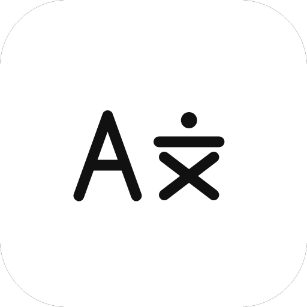

<p align="center">
  
</p>

<h1 align="center">Studious</h1>

<p align="center">把屏幕上看到的外语，就地变成看得懂的中文。</p>

<p align="center">
  
  
  
  
</p>

---

## 这是什么

Studious 是一个桌面翻译工具，围绕「**你正在看的东西**」而不是「你要复制到哪儿去」设计。

> **目前仅支持 Windows 10 / 11（x64）。** 代码里留了平台接缝（抓屏 / 热键 / 浮层排除都收在一层接口后面），但没有 Linux / macOS 的实现，也没有在别的系统上验证过。

三种形态覆盖三种场景：

- **截图翻译** —— 按一下热键框选屏幕，译文直接贴在原文上，不用切窗口、不用复制粘贴。
- **小窗翻译** —— 一个置顶小悬浮窗，随手贴一段文字回车就翻，不打断你手上正在做的事。
- **实时翻译** —— 锁定屏幕上一块区域（字幕、对话框、游戏 UI），内容变了就重翻，逐行贴回去。

底层不绑定翻译服务：Web 免 key 引擎、任意 OpenAI 兼容的云端 LLM、本地跑的 llama.cpp、以及离线的 OPUS-MT 语言包，四条路按你设的优先级自动降级。想全程离线、数据不出机器，只用后两条就行。

## 特性

**翻译链路**

| 能力 | 说明 |
|---|---|
| 四类引擎 | Web（Google / MyMemory）、云端 LLM、本地 LLM（llama.cpp）、本地 MT（OPUS-MT） |
| 自动降级 | 按优先级逐个尝试；网络 / 超时 / 5xx 换下一个，语言对不支持这类语义错误直接停 |
| 本地 MT | 6 个语言对 + 多语言模型兜底，纯 CPU 可跑；可选常驻「开机自启」与「空闲释放」 |
| 本地 LLM | CPU / Vulkan 双后端，模型热切换，上下文 / 线程 / GPU 层数可调；只装了 Vulkan 运行时时自动锁定 GPU |
| 翻译缓存 | SQLite 落地，缓存键含引擎 / 模型 / 采样参数指纹，换模型不串味 |
| 语言检测 | 14 种语言，不需要额外模型 |
| 可取消 | 译到一半随时能停，LLM 逐段补救与重试路径也会立刻中断 |

**屏幕与识别**

| 能力 | 说明 |
|---|---|
| 抓屏 | GDI `BitBlt` 优先，整块全黑时自动切 DXGI Output Duplication（硬件平面 / MPO 的游戏窗口也能取到画面） |
| OCR | PP-OCRv4 检测（DBNet）+ PP-OCRv5 多语种识别（CRNN/CTC，含假名）；宽行按空白列切片，词级坐标还原成行供贴纸对齐 |
| 框选体验 | 放大镜、八向手柄、方向键微调、选区拖拽缩放、选完即译、自动复制 |

**桌面集成与数据**

| 能力 | 说明 |
|---|---|
| 全局热键 | 截图 / 小窗 / 实时 / 打开主页 / 划词五条，默认留空（避免撞车），页内录制、即时生效、冲突就地提示 |
| 界面 | Qt Quick 六页（翻译 / 快捷键 / 浮层 / 配置 / 设置 / 外观），中英双语，强调色按 OKLab 推导整套配色，三套内置字体 |
| 翻译记录 | 截屏 / 小窗 / 实时三个库（`capture.db` / `mini.db` / `live.db`），界面按时间合并展示 |
| 进程安全 | 单实例、关闭到托盘、Job Object 兜底防孤儿进程、`llama-server` 启动风暴防护 |
| 数据自持 | 全部运行时数据在 `<应用目录>/data/`，整个目录可直接搬走；API Key 走 Windows DPAPI 加密 |
| 资产系统 | 清单下载 + 校验和 + 验签、多源下载、断点续传、原子安装、按文件导入 |

## 快速开始

**用打包好的绿色版**（免安装，解压即用）：

从 [Releases](https://github.com/hua-2006/Studious/releases) 下载 `Studious-<版本>-win64.zip`，解压到任意目录，双击 `studious.exe`。

> 模型和 llama runtime 不随包分发（体积太大）。首次运行「本地 MT / 本地 LLM」会显示未装，去「设置 → 资产」按需下载；云端引擎需要自己填 API 地址与 Key。

**从源码构建**：

```powershell
.\build.ps1 -Test          # 自动定位 Qt；-QtRoot D:\Qt -QtVer 6.12.0 可指定位置
.\frontend\build\studious.exe
```

依赖：Qt 6.12+（Core / Gui / Quick / QuickControls2 / Qml / Concurrent / Network / Sql）、MinGW GCC 13.1 或 MSVC 2022、CMake 3.30+、Ninja。第三方库（Monocypher、miniz、sentencepiece、onnxruntime）已内置，**构建过程无需联网**。

> 运行前把 Qt 的 `bin` 目录加进 `PATH`，否则会以 `0xC0000135`（找不到 DLL）静默退出。

也可以只出绿色包：`.\package.ps1` —— 编译 Release → `windeployqt` 部署 Qt → 依赖自检 → 包内冒烟 → 生成 `dist\Studious-<版本>-win64.zip`。

## 三种形态怎么用

**截图翻译** —— 先在「快捷键」页给「截图翻译」录一条热键，按下去框选 → 松手后点工具栏「翻译」（或在浮层设置里打开「选完直接翻译」）→ 译文贴纸盖在原文上。第一次用要先在「设置 → 资产 → 视觉 / OCR」下载 OCR 三件套（约 15 MB）。

**小窗翻译** —— 翻译页的「小窗口」卡片或热键唤起：粘 / 输入文本 → `Ctrl+Enter` 翻译，结果按目标语言分页签、可逐段复制；「记录」页签是三库合并的历史。

**划词翻译** —— 给「场景快捷键 → 划词翻译」录一条热键：读剪贴板 → 填进小窗 → 短文本（≤1500 字）直接翻，长文只填入让你先看一眼。

**实时翻译** —— 翻译页的「实时翻译」卡片或热键唤起 → 框选区域 → 点「开始实时翻译」。控制条可换引擎、换语言、锁定选区、暂停 / 继续；刷新间隔、是否只在内容变化时翻译、区域底色与译文字号在「浮层 → 按功能设置 → 实时翻译」里调。识别不到文字只跳过该帧，不会自行停止。

三个入口共用「配置」页里的同一个引擎和翻译页那套源 / 目标语言（本地 MT 会把目标语言收成单选，因为它按语言对装模型）。

## 翻译引擎

| 引擎 | 离线 | 依赖 |
|---|---|---|
| **web** | ❌ | 免 key（Google / MyMemory），Azure 仅留接口 |
| **llm（云端）** | ❌ | OpenAI 兼容 API |
| **llm（本地）** | ✅ | llama.cpp runtime + GGUF 模型 |
| **local-mt** | ✅ | OPUS-MT 语言包（约 100 MB/对） |

默认降级链：`本地 LLM → 本地 MT → 云端 LLM → Web`，可在「配置 → 引擎」里拖动改顺序，也可以强制只用某一个。本地 MT 的路径选择是：直连 → 英文中转 → 多语言模型兜底。

## 架构

前后端分离，两个兄弟目录：

```
frontend/   界面层（Qt Quick / QML + 少量 C++ 桥）
            qml/          页面、组件、浮层（overlay/）
            src/          AppBackend（QML 与后端的唯一桥）、主题、设置、抓屏编排
            src/platform/ 平台接缝：抓屏 / 浮层排除 / 全局热键 / 托盘 / 单实例 / 进程兜底
backend/    翻译引擎 + OCR（C++20 + Qt Core，平台无关）
            contract / router / translators / mt / ocr / asset / cache / i18n
```

边界约定：

- `backend/` 不含任何平台相关头文件 —— `windows.h` 只允许出现在 `frontend/src/platform/` 的 `.cpp` 里。OCR 在 `backend/src/ocr/`，输入是内存里的 `QImage`，不认识窗口、句柄与显示器。
- QML 只通过 `AppBackend` 访问后端，不直接引用 `studious::*` 类型。
- 平台差异（抓屏 / 热键 / 浮层排除）全部收在 `frontend/src/platform/` 后面，由运行时能力查询驱动界面，不用编译期 `#ifdef`。

界面六个页面：翻译（起点页）、快捷键、浮层、配置、设置、外观。默认 1120×720 逻辑像素，最小 1040×660。

## 数据目录

所有运行时数据都在 **`<应用目录>/data/`**（程序从 exe 往上找 `version.json` 定位），不写 `%APPDATA%`：

```
data/
├─ assets/
│  ├─ models/llm/      本地 LLM 的 GGUF
│  ├─ models/mt/       本地 MT 语言包（每对一个目录）
│  ├─ models/ocr/      OCR 三件套 + run/（启动时收拢的 det.onnx / rec.onnx / 字典）
│  ├─ runtime/         llama.cpp 加速组件（vulkan / cpu）
│  ├─ downloads/       .part 临时文件
│  ├─ state/           asset-origins.json（download / import）
│  └─ logs/            llama-server 日志
├─ logs/               应用日志（studious.log，8 MB 轮转）
├─ records/            capture.db / mini.db / live.db
└─ cache.db            翻译缓存
```

搬机器直接打包整个 `data/`。仓库 `.gitignore` 只放行 `data/README.md`（结构说明），模型与日志都不入库。

双击左上角 logo 可以打开独立日志窗口（跟随最新、复制、清空、打开目录）。

## 命令行

```powershell
# 文本翻译（不开 GUI）
studious.exe --smoke "Hello, world!" --to zh --engine llm-cloud
#   --engine  自动 | web | llm-cloud | llm-local | local-mt（默认走设置里的优先级）
#   --from <lang> --to <lang>        不给 --to 就用设置里的目标语言
#   --provider <google|mymemory>     Web 来源
#   --cache on|off
#   --local --local-gpu on|off --local-model <file>    本地 LLM

# 模型目录
studious.exe --list-models

# 本地 MT 自测
backend_selftest.exe --mt          # 直连语言对
backend_selftest.exe --mt-mul      # 多语言兜底
backend_selftest.exe --mt-bench    # 性能对比

# 资产
studious.exe --assets-cli backend\asset\manifest.json
studious.exe --asset-download backend\asset\manifest.json <assetId>
```

程序是 GUI 子系统（双击不弹控制台）；带参数从终端启动时会把父进程控制台接回来，上面这些命令的输出照常可见。

## 字体

界面、译文、等宽三套字体已内置（思源黑体、霞鹜文楷、霞鹜文楷等宽），经独立静态库 `studious_fonts` 编进 qrc。

为控制体积做过子集化（`frontend/resources/fonts/subset.py`，可重跑）：拉丁 + 通用标点 / 箭头 / 数学 / 几何 + CJK 标点与假名 + GB2312 全量 + JIS X 0208 汉字 + KS X 1001 音节 + 项目源码里实际出现过的字，共 14,524 字符，97 MB 收到 30 MB；日文、繁体、韩文样例逐字查 cmap 均无缺字。

外观页可在三套内置字体、系统默认与任意已装字体之间切换。字体遵循 SIL Open Font License 1.1，许可证见 `frontend/resources/fonts/OFL.txt`。

> 别把字体资源挂回 `studious` 目标本身 —— `qt_add_resources` 会把它们塞进 SOURCES，`lupdate` 逐条解析几十 MB 的字体文件会卡死。

## 版本

版本号与渠道名读仓库根的 `version.json`，提交号构建期从 git 取。发版只需要改 `version.json` 再打一个 `vX.Y.Z` 标签。当前 `1.1.1`，版名 **Erstling**。

变更历史见 [Releases](https://github.com/hua-2006/Studious/releases)；待做项与已知缺口见 [`TODO.md`](TODO.md)。

## 已知限制

- **只支持 Windows**：抓屏、全局热键、浮层排除、托盘、单实例这些都是 Windows 实现；Linux / macOS 目前是空实现，没有验证过。
- 资产清单验签的公钥已接好、`STUDIOUS_REQUIRE_SIGNED_MANIFEST=1` 可强制，但默认尚未打开。
- 导入模型必须落到清单里的某一条；「随便丢个 GGUF 就能用」还没做。

## 许可

[MIT](LICENSE)。第三方组件与字体许可证见程序内「设置 → 关于 → 第三方声明」，贡献者见 [`CONTRIBUTORS.md`](CONTRIBUTORS.md)。
