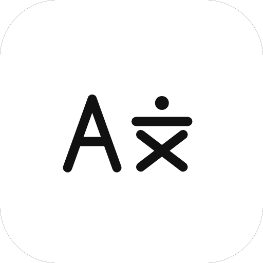
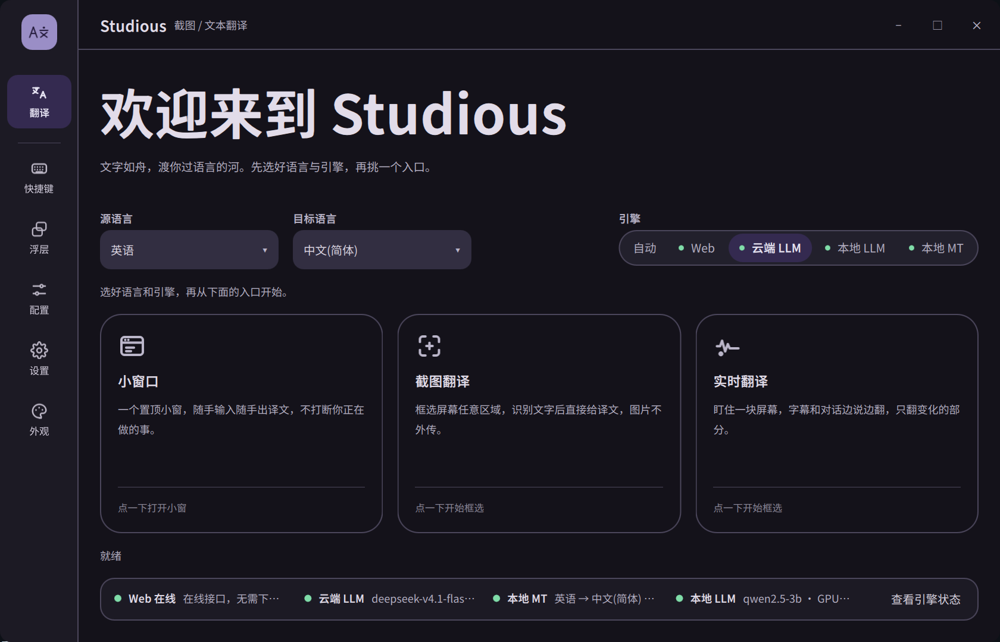
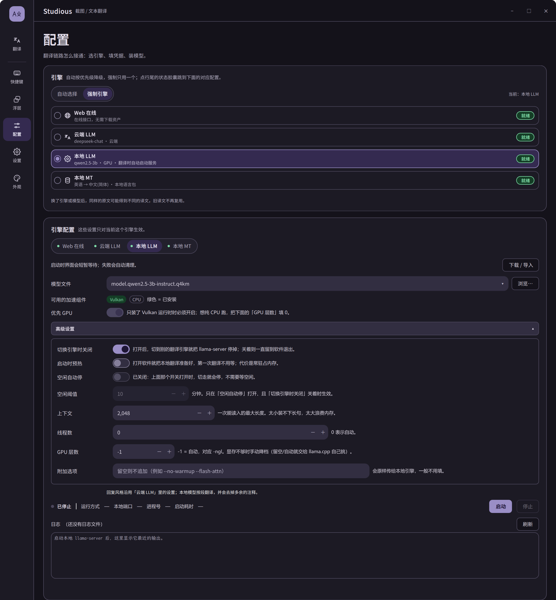

<p align="center">
  
</p>

<h1 align="center">Studious</h1>

<p align="center">截图、划词、实时翻译 —— 把屏幕上看到的外语，就地变成看得懂的语言。</p>

<p align="center"><a href="README.md">English</a> · <b>简体中文</b></p>

<p align="center">
  <a href="https://github.com/hua-2006/Studious/releases"></a>
  
  
  
</p>



## 它能做什么

大多数翻译工具要求你先复制、再切窗口、再粘贴。Studious 管的是「你眼睛正在看的那块屏幕」：

- **截图翻译** —— 按一下热键框选任意区域，识别出文字、翻译，译文直接贴在原文上面。不用切窗口，不用复制。
- **小窗翻译** —— 一个置顶的小悬浮窗，随手贴一段文字回车就翻。写邮件、看文档时不用离开当前窗口。
- **实时翻译** —— 锁定屏幕上一块区域（视频字幕、游戏对话框、软件界面），内容一变就重新翻译，逐行贴回去。

中英日韩等 14 种语言互译。翻译可以走在线接口，也可以完全离线：本地 LLM 和本地语言包都不联网，截图、识别、翻译全程不出你的机器。

## 下载

到 [**Releases**](https://github.com/hua-2006/Studious/releases) 取最新版（`v0.1.0`），两个包功能完全一样，挑顺手的：

**安装版** · `Studious-0.1.0-setup.exe`

1. 双击，一路下一步。默认装到当前用户目录（`%LOCALAPPDATA%\Programs\Studious`），**不需要管理员权限**。
2. 开始菜单里会有图标。卸载走「设置 → 应用」，或安装目录里的 `unins000.exe`。

**绿色版** · `Studious-0.1.0-win64.zip`

1. 解压到一个空文件夹（**别只把 exe 拖出来**，Qt 运行库就在旁边）。
2. 双击 `studious.exe`。删掉文件夹就干净了。

> 数据（模型、缓存、翻译记录、日志）都放在程序旁边的 `data/`，安装版也一样 —— 换台机器时连文件夹一起拷就能接着用。
> 系统要求：Windows 10 / 11（64 位）。目前只有 Windows 版本。

## 第一次用，三步

1. **启动** —— 会弹四页新手引导，讲清三个入口和四种引擎怎么选。看完点「开始使用」；想再看一次，「设置 → 通用 → 启动时显示新手引导」。
2. **录一条热键** —— 「快捷键 → 截图翻译 → 录制」，按你顺手的组合键。默认是空的，避免和别的软件撞车。
3. **试试截图翻译** —— 按下热键框选一段外文，松手点「翻译」，译文就贴在原文上了。

截图翻译要用的 OCR 模型**已经内置**（约 20 MB），装完就能识别，不用另外下。
想用本地引擎（不联网）就到「配置 → 引擎」下模型和运行时，右上角会挂一张任务卡，显示下载 → 校验 → 解压 → 安装 → 「可用」；想用云端 LLM 就到「配置 → 云端 LLM」填接口地址和 Key。

## 三种用法

### 截图翻译

按下热键 → 框选区域（有放大镜和方向键微调，能对准 8px 的小字）→ 点工具栏「翻译」→ 译文贴纸盖在原文上，可以复制。

在「浮层 → 截图翻译」里可以把「选完直接翻译」「复制后自动关闭」打开，框完就出结果，一步到位。

### 小窗翻译

翻译页点「小窗口」，或者按你录的热键：贴文本 → `Ctrl+Enter` 翻译。结果按目标语言分页签，能逐段复制；「记录」页签里是历史翻译。

### 实时翻译

翻译页点「实时翻译」或按热键 → 框选一块区域 → 「开始实时翻译」。控制条上能换引擎、换语言、锁定选区、暂停继续。

适合字幕、弹幕、游戏对话这类会变的内容。识别不到文字时会跳过那一帧，不会自己停下来。

## 翻译引擎怎么选

| 引擎 | 需要联网 | 适合谁 |
|---|---|---|
| **Web** | 是 | 装了就能用，不用任何配置，质量够日常 |
| **云端 LLM** | 是 | 有 OpenAI 兼容接口（DeepSeek、通义、自建网关都行），译文更自然 |
| **本地 LLM** | 否 | 有独显、想要最好质量又不想把内容发出去 |
| **本地 MT** | 否 | 纯 CPU 也能跑，速度快，字幕/实时场景够用 |

默认顺序是 `本地 LLM → 本地 MT → 云端 LLM → Web`：能本地就本地，本地没装就往后让。哪一个超时或报错，会自动换下一个；「语言对不支持」这类错误则直接停，不会瞎试。

顺序可以在「配置 → 引擎」里拖动调整，也可以「强制引擎」只用某一个。



## 界面导览

| 页面 | 干什么 |
|---|---|
| **翻译** | 起点页：选语言、选引擎、进小窗 / 截图 / 实时三个入口，底部是引擎状态条 |
| **快捷键** | 给三种形态和划词、打开主页各录一条全局热键，冲突会就地提示 |
| **浮层** | 截图、小窗、实时三种浮层的细节：放大镜、遮罩深浅、刷新间隔、译文字号 |
| **配置** | 引擎优先级、四类引擎各自的参数（API、模型、线程、GPU 层数等） |
| **设置** | 通用、翻译行为、缓存、网络、资产、数据、关于 |
| **外观** | 明暗模式、强调色、界面 / 译文字体、字号 |

界面中英双语，在「设置 → 通用 → 界面语言」切换（切完重启生效）。

## 隐私和数据

- **API Key 用 Windows DPAPI 加密**存在本机，换账户或换电脑都解不开。程序里没有内置任何第三方地址和 Key。
- 用本地引擎（本地 LLM / 本地 MT）时，截图和文字**完全不联网**；用在线引擎时只把识别出的文字发给翻译接口，图片本身不外传。
- 所有数据都在程序旁边的 `data/` 文件夹：模型、翻译缓存、翻译记录、日志。整个文件夹可以直接拷到另一台机器接着用，删掉就等于恢复出厂。
- 双击界面左上角的 logo 能打开日志窗口，出问题时看那里最快。

## 常见问题

**本地 LLM / 本地 MT 是灰的，写着「未装」？**
这两个的运行时和模型太大，没打进安装包（包里只有 OCR 模型）。到「配置 → 引擎」点下载，右上角会显示进度直到「可用」；也可以把别人机器上的 `data/assets` 整份拷过来。

**安装版把我东西装哪了？**
默认 `%LOCALAPPDATA%\Programs\Studious`，数据就在同一个文件夹下的 `data/`。想全机共用可以装到 `Program Files`，但那样 `data/` 需要管理员权限才写得进去，日常用不推荐。

**双击会弹黑框吗？**
不会，程序是 GUI 程序。从终端带参数运行才会接回控制台输出，那是给排错用的。

**能装在 U 盘 / 换台电脑用吗？**
能。绿色版，数据跟着文件夹走；新机器上重新指一次模型路径就行。

**截图抓不到游戏画面 / 全黑？**
先用普通窗口试试。独占全屏的游戏可能抓不到，切成无边框窗口模式通常就好了。

**想要完全离线？**
本地 MT 或本地 LLM 二选一装好，然后在「配置 → 引擎」里只勾离线引擎。全程不联网。

**翻译记录能清吗？**
能。「设置 → 数据」里可以清空缓存和记录，也可以直接删 `data/records`、`data/cache.db`。

## 自己编译（可选）

需要 Qt 6.12+、CMake 3.30+、MinGW GCC 13.1 或 MSVC 2022。第三方库随仓库带，编译不需要联网。

```powershell
.\build.ps1 -Test                     # 自动找 Qt，编译并跑自测
.\frontend\build\studious.exe         # 直接运行
.\package.ps1 -WithVision             # 绿色包 dist\Studious-<版本>-win64.zip（带 OCR 模型）
.\package.ps1 -MakeInstaller          # 安装包 dist\Studious-<版本>-setup.exe（需 Inno Setup 6）
```

## 更新日志

### 0.1.0

**截图翻译：译文块可以直接点了**

- 单击译文块即选中（整块背景变色）；按 Ctrl+C 或点工具栏「复制」复制所有选中的块，一块没选就复制整屏。
- 显示译文时复制译文，显示原文时复制原文，不用再自己对。
- 也能像在文档里那样用鼠标拖选译文中的几个字，Ctrl+C 只复制这一段（与块选中互不影响）。
- 复制成功会在工具栏上方弹「✓ 已复制」，不会再出现点了没反应。

**认得更准**

- 新增视觉档位「快速 / 标准 / 精确」：快速省电，精确会把大图分块识别，长截图和 4K 屏明显更稳（配置 → 视觉引擎配置）。
- 深色界面自动反色，白字黑底也能认；深色里嵌浅色卡片可以手动指定。
- 横排标签（导航栏那种一行很多列）按文字间隙切开，不再把「问题 拉取请求 代理」并成一句。
- 译文比原文长时自动换行、略微缩字号并避开右侧的下一块，不再互相压字。

**翻得更稳**

- 重写默认提示词：只输出译文，保留数字、版本号、文件名、URL、代码标识符与品牌名；界面短文字只给简短译名，不再自作解释。
- 原文已经是目标语言时直接原样显示，不再白发一次请求，也不再误报「翻译失败」。
- 带品牌名的句子（例如「基于MSBuild的项目」）不再被误判成没翻译；确实翻不出的段落改为显示原文，并在状态栏说明「N 段没有翻成…」，不再整屏报错。

**实时翻译**

- 控制条新增「刷新」，立刻重采一帧；同屏文字没变时也会强制重翻。
- 选区贴到屏幕边缘时，工具栏自动放进选区里，不再跑到屏幕外；点暂停也不会再把工具栏弹回原位。

**设置**

- 新增「复制后关闭」：点复制后立刻收起浮层。
- 新增小窗独立字号（11–28 px，默认 17），与外观页的字号互不影响。
- 「浮层 → 按功能设置」改名为「功能设置」，并移除「保留原文标注」。

**新手引导与下载提示**

- 首次启动有四页新手引导：欢迎、三种入口、引擎对比、开始使用；中英文各自排版，窄窗口也不会被裁。
- 引导期间点不到、也碰不到底下的按钮，看完点「开始使用」或「不再提示」即可；想再看一次，设置 → 通用 → 「启动时显示新手引导」。
- 下载资产时右上角会挂一张任务卡：下载百分比 → 校验 → 解压 → 安装 → 「可用」，成功绿色、失败红色，可用后 2 秒自动收起。
- 同时下多个时只显示三行，其余收进「+N」，点开可滚动看全部。

**其他**

- 日志能看到全过程：识别出的文字、提交给引擎的文本、引擎的原始回复与失败原因（`data/logs/studious.log`）。
- 启动不再弹出黑色控制台窗口。
- 发行包不再携带开发机上的测试接口地址与密钥。
- 新增 Inno Setup 安装版（免管理员、可卸载干净）；绿色版打包可把 OCR 模型一起带上。

## 反馈

用着有问题、想要什么功能，开个 [Issue](https://github.com/hua-2006/Studious/issues)。贴日志（`data/logs/studious.log`）会快很多。

## Vibe coding

本项目使用deepseek-V4.1-Flash 辅助构建

## 当前进度

1. ~~用户自定义导入本地 llm 模型~~ — 已完成：配置页「浏览…」或资产页「从文件导入」；本地 mt 语言包导入暂缓（原始 opus-mt 包要先导出+量化，接口位置已留）
2. ~~软件初始引导~~ — 已完成：首次启动四页引导（欢迎 / 三种入口 / 引擎对比 / 开始使用），双语自适应，设置 → 通用 可重新打开或关闭
3. 加入更多的web翻译源
4. ~~优化增强图像识别准度,增加图像识别档位~~ — 已完成三档（快速 / 标准 / 精确）、深色自动反色、横排标签切分、译文块避让排版；继续调阈值与短标签译法

## 许可证

[MIT](LICENSE)。内置字体与第三方组件的许可证见程序内「设置 → 关于 → 第三方声明」。


